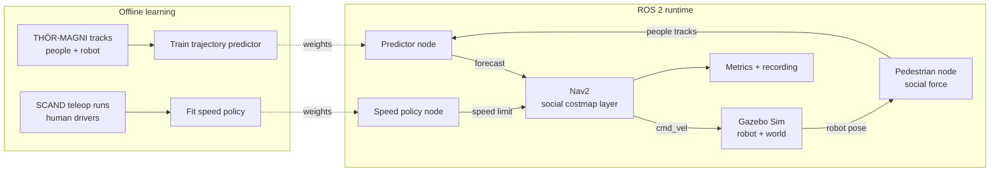

# Social Navigation with Learned Pedestrian Prediction (ROS 2 + Nav2)

A mobile robot that learns from real people how to move through a crowd. A trajectory predictor trained on real human–robot interaction data forecasts where pedestrians will walk, and Nav2 plans around that forecast. A speed policy learned from human teleoperators sets how fast the robot moves near people.


> **Status:** in progress. Results and demo videos will appear below as runs complete.

## Demo

_Coming soon: side-by-side videos of the three set-ups in the crossing, corridor and crowd scenarios._

## The question

Does predicting where people will go, using models learned from real human–robot data, make a robot navigate more safely and more socially than a standard planner?

## Approach



### Three set-ups compared

| Set-up | Costmap | Speed near people |
| --- | --- | --- |
| **A. Baseline** | Nav2 default (people as current obstacles) | Nav2 default |
| **B. + Prediction** | Adds a layer of predicted pedestrian occupancy | Nav2 default |
| **C. + Prediction + human speed policy** | Predicted occupancy | Learned from human drivers in SCAND |

### Metrics

Collisions, minimum distance to any pedestrian, personal-space intrusions, time to goal and path smoothness. The robot's clearance is also compared with the clearance that human drivers kept in SCAND.

## Results

_Pending._

## Data

| Dataset | Role |
| --- | --- |
| [THÖR-MAGNI](https://doi.org/10.5281/zenodo.10407223) | Motion-capture tracks of people walking around a robot; trains the predictor |
| [SCAND](https://www.cs.utexas.edu/~xiao/SCAND/SCAND.html) | Human-teleoperated robot runs among people; trains the speed policy and gives a human reference |

See [`data/README.md`](data/README.md) for download steps.

## Repository layout

```
ros2_ws/src/     ROS 2 packages: pedestrian sim, predictor node, costmap layer, speed policy, bringup
learning/        Training code for the predictor and the speed policy
experiments/     Scenario and run configs; scripts for the experiment grid
results/         Summary tables and plots (full bags and videos are in Releases)
docker/          Container with ROS 2 Jazzy, Nav2 and Gazebo
docs/media/      Figures and GIFs used in this README
```

## Reproduce

_Instructions will be added with the first working release._

## Earlier prototype

This project grows out of a MATLAB prototype of crowd navigation with learned pedestrian prediction: [crowd-nav-matlab](https://github.com/filmonnezif/crowd-nav-matlab) (tag `matlab-fallback-v1`).

## Licence

Code is MIT-licensed. Datasets keep their own licences.
