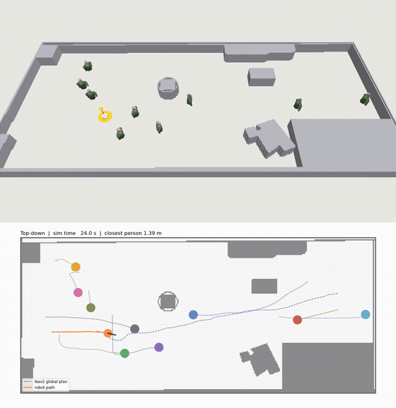
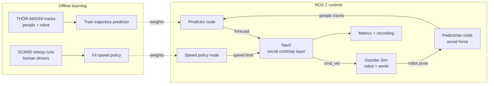

# Social Navigation with Learned Pedestrian Prediction (ROS 2 + Nav2)

A mobile robot that learns from real people how to move through a crowd. A trajectory predictor trained on real human–robot interaction data forecasts where pedestrians will walk, and Nav2 plans around that forecast. A speed policy learned from human teleoperators sets how fast the robot moves near people.


> **Status:** in progress. Results and demo videos will appear below as runs complete.

## Demo

**Nav2 baseline among 9 real people replayed from THÖR-MAGNI.** The room comes from the dataset's floor map and every person walks their recorded trajectory as an animated figure. The orange robot crosses the room and returns; the bottom panel shows the same moment from above with the Nav2 plan.



Full video, rosbag and metrics: see [Releases](../../releases). The replayed people do not react to the robot (they are recordings), so this run is a stress test for the planner, not a model of how people respond.

## The question

Does predicting where people will go, using models learned from real human–robot data, make a robot navigate more safely and more socially than a standard planner?

## Approach



### Three set-ups compared

| Set-up | Costmap | Speed near people |
| --- | --- | --- |
| **A. Baseline** | Nav2 default (people as current obstacles) | Nav2 default |
| **B. + Prediction** | Adds a layer of predicted pedestrian occupancy | Nav2 default |
| **C. + Prediction + human speed policy** | Predicted occupancy | Learned from human drivers in SCAND |

### Metrics

Collisions, minimum distance to any pedestrian, personal-space intrusions, time to goal and path smoothness. The robot's clearance is also compared with the clearance that human drivers kept in SCAND.

## Results

| Run | Set-up | Goals reached | Time per goal | Min distance to a person | Time within 0.5 m | Time within 1 m |
| --- | --- | --- | --- | --- | --- | --- |
| [actors_run_v2](results/actors_run_v2/metrics.json) | A. Baseline (walking figures) | 2 / 2 | 47.8 s, 44.4 s | 0.09 m | 4.9 s | 26.8 s |
| [first_run](results/first_run/metrics.json) | A. Baseline (simple bodies, tracking gaps not yet bridged) | 2 / 2 | 47.9 s, 48.5 s | 0.10 m | 6.1 s | 21.8 s |

Motion capture loses people's helmets for up to ~12 s while they keep walking (31% of samples in this window). Since `actors_run_v2` these gaps are bridged by interpolation, so people walk continuously instead of vanishing and reappearing; that is also why its numbers differ from `first_run`. The robot's lidar sees about 85% of the people within 3 m in both versions (the rest are hidden behind other people or obstacles). The baseline reaches its goals but passes very close to people, because Nav2 only sees where people are now, not where they are going. That gap is what the predictor targets.

## Data

| Dataset | Role |
| --- | --- |
| [THÖR-MAGNI](https://doi.org/10.5281/zenodo.10407223) | Motion-capture tracks of people walking around a robot; trains the predictor |
| [SCAND](https://www.cs.utexas.edu/~xiao/SCAND/SCAND.html) | Human-teleoperated robot runs among people; trains the speed policy and gives a human reference |

See [`data/README.md`](data/README.md) for download steps.

## Repository layout

```
ros2_ws/src/     ROS 2 packages: pedestrian sim, predictor node, costmap layer, speed policy, bringup
learning/        Training code for the predictor and the speed policy
experiments/     Scenario and run configs; scripts for the experiment grid
results/         Summary tables and plots (full bags and videos are in Releases)
docker/          Container with ROS 2 Jazzy, Nav2 and Gazebo
docs/media/      Figures and GIFs used in this README
```

## Reproduce

Needs Podman (or Docker) and a GPU that Mesa supports for headless rendering.

```bash
podman build -t localhost/social-nav:jazzy -f docker/Containerfile docker

# one-off: turn a THÖR-MAGNI run into a world, a Nav2 map and a people file
python learning/data/thor_magni.py <THOR_MAGNI>/CSVs_Scenarios/Scenario_3/THOR-Magni_120522_SC3A_R1.csv tracks.csv
python experiments/build_scene.py tracks.csv <THOR_MAGNI>/maps/1205_SC3_map.png --t0 120 --duration 110

# run, record and render one episode -> results/<name>/{bag,run.mp4,demo.mp4,metrics.json}
experiments/run_episode.sh my_run
```

## Earlier prototype

This project grows out of a MATLAB prototype of crowd navigation with learned pedestrian prediction: [crowd-nav-matlab](https://github.com/filmonnezif/crowd-nav-matlab) (tag `matlab-fallback-v1`).

## Licence

Code is MIT-licensed. Datasets keep their own licences.
