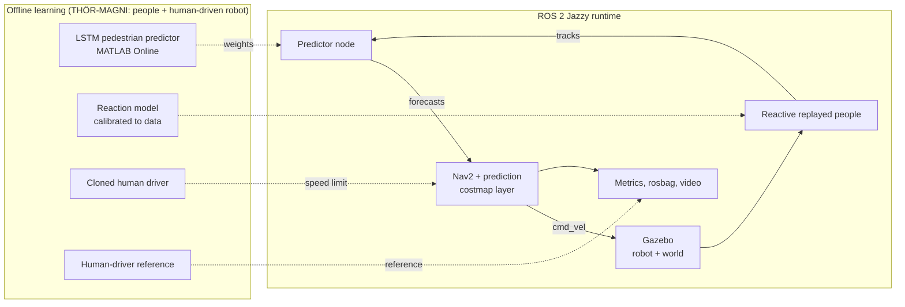
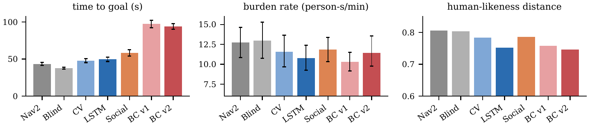
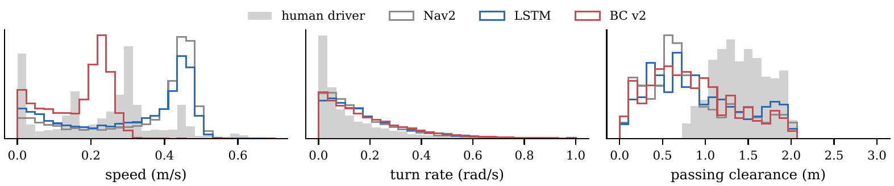
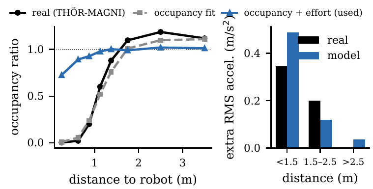

# Social Navigation with Learned Pedestrian Prediction (ROS 2 + Nav2)

Can learning from real human–robot interaction data make a standard ROS 2/Nav2 robot move through a crowd more like a human-driven robot: smoothly, legibly, and without pushing people aside?

This repository holds the full pipeline, every experiment and the paper. A pedestrian predictor trained on the [THÖR-MAGNI](https://doi.org/10.5281/zenodo.10407223) dataset feeds Nav2 through a costmap layer. Real recorded people are replayed in Gazebo and react to the robot with a model calibrated to the data. The robot is judged against the human-driven robot in the same dataset.


> **Paper:** [*Learned Pedestrian Prediction for Nav2 in Data-Calibrated Reactive Crowds, Measured against a Human-Driven Robot*](paper/main.pdf) (6 pages, IEEE conference format). **Status:** complete; 224 recorded navigation episodes plus an earlier 128-episode experiment.

## Demo

Nav2 among 7 real people replayed from THÖR-MAGNI (recording 170522_SC3A_R1, the best-tracked stretch of the dataset: 99.7% recorded positions). The room is built from the dataset's floor map and every person walks their recorded path. The bottom panel shows the same moment from above, with the Nav2 plan.


Every episode is recorded as a rosbag and a video. Videos, bags and the side-by-side comparison are in [Releases](../../releases).

## Key findings

1. **Learned prediction is better than constant velocity.** An LSTM that sees nearby people cuts displacement error by 25% (ADE 0.95 m vs 1.26 m over 4.8 s) on a held-out recording day.
2. **In Nav2, prediction changes how the robot disturbs people, not how much.** With LSTM forecasts in the costmap, the robot pushes people off their paths 15% less often per minute (95% CI 4–26%), and its motion is the closest to the human driver's. It is 14% slower, so total disturbance is unchanged.
3. **Slowing down near people makes things worse for them.** A rule-based yielding policy and a cloned human driver both raised time close to people, stop-starts and total disturbance. People walk about four times faster than the robot, so a robot that waits stays in their way for longer.
4. **Cloning the human driver failed, for known reasons.** The cloned driver copied its own past velocity (the copycat problem) and then read its pace off the subgoal distance. A people-only version showed that the operator's speed in THÖR-MAGNI barely depends on the people around it (correlation 0.06).
5. **A robot that ignores people looks almost as good** when people step aside. The calibration matters: our people do no more extra work than real participants did, which keeps that gap small but positive.

## Approach



### Set-ups compared

All set-ups use the same Nav2 stack (NavFn + MPPI) and the footprint of THÖR-MAGNI's DARKO robot (0.90 × 0.75 m).

| Set-up | What changes |
| --- | --- |
| **Nav2** | Stock costmaps; people appear only through the lidar |
| **Blind** (control) | No obstacle layers: the robot ignores people and lets them move |
| **CV** / **LSTM** | Plus a costmap layer that paints constant-velocity or LSTM forecasts |
| **Social** | LSTM plus a yielding rule that lowers the speed limit before predicted conflicts, with speed limits from the human driver |
| **BC v1 / v2** | LSTM plus a cloned human driver that sets the speed limit |

### Metrics

Besides success, time to goal and time within 0.5 m:

- **Burden:** person-seconds that reactive people spent more than 0.2 m off their recorded paths, i.e. how much the robot made people move. The burden rate is the same per minute of driving.
- **Human-likeness distance:** the mean Wasserstein distance between the robot's and the human driver's distributions of speed, acceleration, jerk, turn rate, approach speed and passing clearance, in units of the human's interquartile range (0 means identical).
- Smoothness: stop-starts per minute, jerk, heading change per metre, and time with time-to-collision under 2 s.

All comparisons use paired bootstrap 95% confidence intervals over 32 scene/direction pairs.

## Results

### Pedestrian prediction

Trained in MATLAB Online ([`train_predictor.m`](learning/matlab/train_predictor.m)) on 36k snippets; tested on a held-out day (17 May, 13k snippets). 3.2 s observed, 4.8 s predicted; mean of 3 seeds.

| Model | ADE (m) | FDE (m) | ADE, robot within 3 m (m) |
| --- | --- | --- | --- |
| Constant velocity | 1.258 | 2.845 | 1.158 |
| LSTM, own motion | 1.065 | 2.322 | 1.063 |
| LSTM + 4 nearest people | **0.946** | 1.944 | 0.948 |
| LSTM + people + robot | 0.952 | **1.933** | **0.935** |

Adding the robot as an input helps near the robot by only 1.4%, so the data give no clear sign that people react to the teleoperated robot.

### Navigation in a reactive crowd

16 scenes from the held-out day × 2 crossing directions = 32 paired runs per set-up ([`results/final_grid`](results/final_grid/summary.md)).

| Set-up | Success | Time to goal | Within 0.5 m | Stop-starts /min | Burden (person-s) | Burden /min | Human-likeness |
| --- | --- | --- | --- | --- | --- | --- | --- |
| Nav2 | 100% | 43 s | 1.46 s | 4.8 | 9.5 | 12.7 | 0.81 |
| Blind (ignores people) | 100% | **38 s** | 1.52 s | **3.3** | **8.4** | 13.0 | 0.80 |
| CV prediction | 100% | 48 s | 1.56 s | 5.0 | 9.7 | 11.6 | 0.78 |
| **LSTM prediction** | 100% | 50 s | 1.57 s | 5.3 | 9.3 | 10.8 | **0.75** |
| Social (LSTM + yielding) | 97% | 58 s | 2.39 s | 6.9 | 12.5 | 11.9 | 0.79 |
| BC v1 (own velocity input) | 78% | 97 s | 3.16 s | 5.6 | 17.6 | **10.3** | 0.76 |
| BC v2 (no own velocity) | 88% | 94 s | 2.76 s | 6.6 | 16.8 | 11.4 | **0.75** |
| *Human driver (THÖR-MAGNI)* | | | | *3.2* | | | *0* |



The cloned drivers' low burden rate comes from crawling (0.16–0.17 m/s): they spread a larger total burden over a longer trip.



The human operator kept a wide berth (median passing clearance 1.42 m) while moving steadily at 0.2–0.3 m/s. No Nav2 variant does both.

### The reactive crowd

Real participants were almost never within 0.75 m of the robot. Fitting only that makes simulated people sidestep by about 1.5 m, far more effort than real people spent. Matching both the distance kept and the extra effort shows that most of the space around the real robot came from its operator steering away. In simulation that job falls to the robot ([`calibrate_reaction.py`](learning/reaction/calibrate_reaction.py)).



### Earlier experiment: small robot, non-reacting people

With a TurtleBot-sized robot among people who replay their recordings without reacting, prediction made the robot hesitate: stop-starts rose by 33% (CV) and 40% (LSTM), and the motion moved away from the human driver's ([`results/h3_grid`](results/h3_grid/motion_summary.md)). This set-up motivated the final one.

### Cloned human driver

Offline results on the held-out day ([`train_driver.m`](learning/matlab/train_driver.m), [`results/driver`](results/driver/metrics.csv)):

| Model | Inputs | Speed error near people (m/s) | Yield moments recognised |
| --- | --- | --- | --- |
| Keep current velocity | own velocity | 0.037 | 83% |
| BC-social (v1) | own velocity, subgoal, 6 nearest people | 0.039 | 88% |
| BC-nocopy (v2) | subgoal, people | 0.045 | 85% |
| BC-people | people only | 0.102 | 10% |

v1 and v2 look fine offline because their inputs give the answer away (own past speed, and a hindsight subgoal whose distance encodes speed). In closed loop they crawl.

## Data cleaning

The motion-capture software often fails to solve a helmet as a rigid body while its markers are visible. [`thor_magni.py`](learning/data/thor_magni.py) then uses the mean of the visible markers (2–8 cm from the true centroid), which raises tracked coverage from ~65% to ~99%. A rolling-median filter and a 2.5 m/s speed gate remove jumps onto another helmet, and short gaps are interpolated and flagged. [`rank_windows.py`](experiments/rank_windows.py) picks the best-tracked windows for scenes.

## Repository layout

```
paper/                      IEEE conference paper (main.tex, main.pdf) and make_figures.py
ros2_ws/src/social_nav_sim/ Launch files and nodes: people replay + reaction, predictor,
                            yielding governor, cloned driver, recorder, episode runner
ros2_ws/src/social_nav_layers/  C++ Nav2 costmap plugin for predicted people
learning/data/              THÖR-MAGNI cleaning and dataset builders
learning/matlab/            Predictor and driver training (MATLAB Deep Learning Toolbox)
learning/reaction/          Reaction-model calibration
experiments/                Scene builder, Nav2 params, grid runner, metrics and analysis
results/                    Summaries, metrics per episode, plots (bags and videos in Releases)
docker/                     Container with ROS 2 Jazzy, Nav2 and Gazebo Harmonic
```

## Reproduce

Needs Podman (or Docker) and a GPU that Mesa supports for headless rendering. See [`data/README.md`](data/README.md) for the dataset.

```bash
podman build -t localhost/social-nav:jazzy -f docker/Containerfile docker

# one episode: world, map and people from a THÖR-MAGNI recording -> results/<name>/{bag,run.mp4,metrics.json}
python learning/data/thor_magni.py <THOR_MAGNI>/CSVs_Scenarios/Scenario_3/THOR-Magni_170522_SC3A_R1.csv tracks.csv
python experiments/build_scene.py tracks.csv <THOR_MAGNI>/maps/1705_SC3_map.png --t0 70 --duration 110
experiments/run_episode.sh my_run

# the final grid (7 set-ups x 32 runs) and its analysis
python experiments/run_grid.py --tracks <tracks_dir> --maps <THOR_MAGNI>/maps \
    --modes none,blind,cv,lstm,social,learned --body darko --reactive --out results/final_grid
python experiments/analyze_h3.py results/final_grid
python experiments/analyze_motion.py results/final_grid

# paper figures and PDF
python paper/make_figures.py && (cd paper && latexmk -pdf main.tex)
```

## Future work

- A driver dataset in which human operators react to crowds: [SCAND](https://www.cs.utexas.edu/~xiao/SCAND/SCAND.html) (teleoperated robots in public spaces) or [MuSoHu](https://arxiv.org/abs/2303.14880) (humans navigating crowds with robot-like sensors). SCAND could not be downloaded during this work.
- A learned, clearance-aware cost for the MPPI controller in place of a speed limit near people.
- Checking the burden metric with real participants.

## Earlier prototype

This project grew out of a MATLAB prototype of crowd navigation with learned pedestrian prediction: [crowd-nav-matlab](https://github.com/filmonnezif/crowd-nav-matlab) (tag `matlab-fallback-v1`).

## Citation

See [`CITATION.cff`](CITATION.cff).

## Licence

Code is MIT-licensed. THÖR-MAGNI is CC-BY-4.0 and keeps its own terms.
