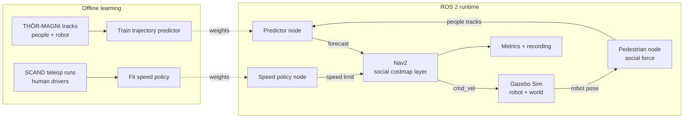
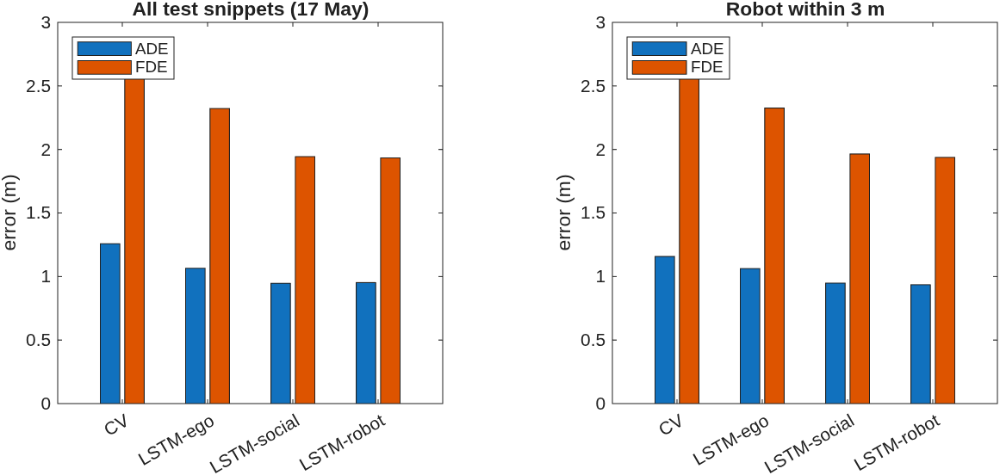
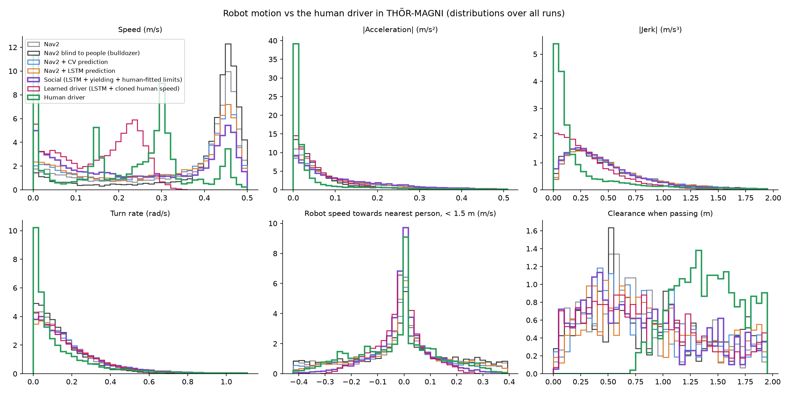

# Social Navigation with Learned Pedestrian Prediction (ROS 2 + Nav2)

A mobile robot that learns from real people how to move through a crowd. A trajectory predictor trained on real human–robot interaction data forecasts where pedestrians will walk, and Nav2 plans around that forecast. A speed policy learned from human teleoperators sets how fast the robot moves near people.


> **Status:** experiments complete for prediction, the reactive crowd and five navigation set-ups; next: fixing the learned driver's copycat input.

## Demo

**Nav2 baseline among 7 real people replayed from THÖR-MAGNI** (recording 170522_SC3A_R1, 70–180 s, picked as the best-tracked stretch of all 16 Scenario 3 recordings: 99.7% recorded positions, longest gap 0.7 s). The room comes from the dataset's floor map and every person walks their recorded trajectory as an animated figure. The orange robot crosses the room and returns; the bottom panel shows the same moment from above with the Nav2 plan.


Full video, rosbag and metrics: see [Releases](../../releases). The replayed people do not react to the robot (they are recordings), so this run is a stress test for the planner, not a model of how people respond.

## The question

Does predicting where people will go, using models learned from real human–robot data, make a robot navigate more safely and more socially than a standard planner?

## Approach



### Three set-ups compared

| Set-up | Costmap | Speed near people |
| --- | --- | --- |
| **A. Baseline** | Nav2 default (people as current obstacles) | Nav2 default |
| **B. + Prediction** | Adds a layer of predicted pedestrian occupancy | Nav2 default |
| **C. + Prediction + human speed policy** | Predicted occupancy | Learned from human drivers in SCAND |

### Metrics

Collisions, minimum distance to any pedestrian, personal-space intrusions, time to goal and path smoothness. The robot's clearance is also compared with the clearance that human drivers kept in SCAND.

## Results

| Run | Set-up | Goals reached | Time per goal | Min distance to a person | Time within 0.5 m | Time within 1 m |
| --- | --- | --- | --- | --- | --- | --- |
| [clean_run](results/clean_run/metrics.json) | A. Baseline (best-tracked recording) | 2 / 2 | 37.3 s, 46.7 s | 0.06 m | 2.0 s | 13.2 s |
| [actors_run_v2](results/actors_run_v2/metrics.json) | A. Baseline (walking figures) | 2 / 2 | 47.8 s, 44.4 s | 0.09 m | 4.9 s | 26.8 s |
| [first_run](results/first_run/metrics.json) | A. Baseline (simple bodies, tracking gaps not yet bridged) | 2 / 2 | 47.9 s, 48.5 s | 0.10 m | 6.1 s | 21.8 s |

`clean_run` is the reference baseline. The two older rows replay a different recording (120522_SC3A_R1) whose tracking had large gaps.

**Data cleaning.** The motion-capture software often fails to solve a helmet as a rigid body even though its markers are visible; [`thor_magni.py`](learning/data/thor_magni.py) then uses the mean of the visible markers (within ~2–8 cm of the true centroid when checked on frames where both exist), which raises tracked coverage from ~65% to ~99%. Mis-solves that jump onto another helmet are removed by a rolling-median filter and a 2.5 m/s speed gate. Remaining short gaps are bridged by interpolation and flagged. [`rank_windows.py`](experiments/rank_windows.py) scores every 110 s window of every recording to pick the demo scene. The robot's lidar sees about 85% of the people within 3 m in both versions (the rest are hidden behind other people or obstacles). The baseline reaches its goals but passes very close to people, because Nav2 only sees where people are now, not where they are going. That gap is what the predictor targets.

### Pedestrian prediction (H1, H2)

Trained in MATLAB Online ([`train_predictor.m`](learning/matlab/train_predictor.m), CPU, 7.6 min for 9 trainings) on 36k snippets of THÖR-MAGNI Scenario 3; tested on a held-out recording day (17 May, 13k snippets). 3.2 s observed, 4.8 s predicted; mean over 3 seeds.

| Model | ADE (m) | FDE (m) | ADE, robot within 3 m (m) |
| --- | --- | --- | --- |
| Constant velocity | 1.258 | 2.845 | 1.158 |
| LSTM, own motion | 1.065 | 2.322 | 1.063 |
| LSTM + 4 nearest people | **0.946** | 1.944 | 0.948 |
| LSTM + people + robot | 0.952 | **1.933** | **0.935** |

- **H1 supported:** learning cuts ADE by 24.8% and FDE by 32% versus constant velocity (target ≥ 15%); most of the gain comes from seeing nearby people.
- **H2 not supported:** adding the robot lowers ADE near the robot by only 1.4% (better in 3 of 4 test recordings, about twice the seed-to-seed spread): a faint, consistent hint that people react to the teleoperated robot, not a clear effect.



The robot-aware model drives the navigation experiment (H3). [`predictor_numpy.py`](learning/predictor_numpy.py) runs the exported weights without MATLAB and reproduces the MATLAB test metrics.

### Navigation in a reactive crowd (final experiment)

DARKO-sized robot (0.90 × 0.75 m, the dataset robot's footprint) among replayed THÖR-MAGNI people who react to it with a model calibrated to the data (they keep their distance about as much as real participants did, and do no more extra accelerating than they did). 16 scenes from the held-out test day × 2 crossing directions = 32 paired runs per set-up. Burden = person-seconds that people were pushed more than 0.2 m off their recorded path. Human-likeness = mean Wasserstein distance between the robot's motion distributions (speed, acceleration, jerk, turn rate, approach speed, passing clearance) and those of the human-driven robot in THÖR-MAGNI, in units of the human's interquartile range.

| Set-up | Reached goal | Time to goal | Time within 0.5 m | Burden (person-s) | Burden per minute | Human-likeness distance |
| --- | --- | --- | --- | --- | --- | --- |
| Nav2 | 100% | 43 s | 1.46 s | 9.5 | 12.7 | 0.81 |
| Nav2 blind to people (control) | 100% | 38 s | 1.52 s | 8.4 | 13.0 | 0.80 |
| + constant-velocity prediction | 100% | 48 s | 1.56 s | 9.7 | 11.6 | 0.78 |
| + LSTM prediction | 100% | 50 s | 1.57 s | 9.3 | 10.8 | **0.75** |
| Social (LSTM + yielding rule + human-fitted limits) | 97% | 58 s | 2.39 s | 12.5 | 11.9 | 0.79 |
| Learned driver (LSTM + speed cloned from the human driver) | 78% | 97 s | 3.16 s | 17.6 | **10.3** | 0.76 |

- Learned prediction lowers the rate at which the robot pushes people off their paths (about 15% per minute versus Nav2) and makes its motion the most human-like, but it is slower, so total burden is unchanged.
- Behaviours that slow the robot down spend longer among people, who walk about four times faster than the robot, and add total burden.
- The learned driver fails in closed loop (0.16 m/s, 22% timeouts): with its own past velocity as an input it copies itself and stays slow once slowed, the known "copycat" problem of behaviour cloning, even though offline it predicted the human driver's velocity 8% better than keeping the current velocity.
- The blind control is worst per minute but only slightly worse than Nav2: at this crowd density Nav2's reactive avoidance changes little. Halving the people's reaction strength gives the same ranking ([`final_grid_half`](results/final_grid_half/summary.md)).



Details: [`results/final_grid/summary.md`](results/final_grid/summary.md), [`motion_summary.md`](results/final_grid/motion_summary.md); reaction model: [`results/reaction`](results/reaction); learned driver: [`results/driver`](results/driver).

## Data

| Dataset | Role |
| --- | --- |
| [THÖR-MAGNI](https://doi.org/10.5281/zenodo.10407223) | Motion-capture tracks of people walking around a robot; trains the predictor |
| [SCAND](https://www.cs.utexas.edu/~xiao/SCAND/SCAND.html) | Human-teleoperated robot runs among people; trains the speed policy and gives a human reference |

See [`data/README.md`](data/README.md) for download steps.

## Repository layout

```
ros2_ws/src/     ROS 2 packages: pedestrian sim, predictor node, costmap layer, speed policy, bringup
learning/        Training code for the predictor and the speed policy
experiments/     Scenario and run configs; scripts for the experiment grid
results/         Summary tables and plots (full bags and videos are in Releases)
docker/          Container with ROS 2 Jazzy, Nav2 and Gazebo
docs/media/      Figures and GIFs used in this README
```

## Reproduce

Needs Podman (or Docker) and a GPU that Mesa supports for headless rendering.

```bash
podman build -t localhost/social-nav:jazzy -f docker/Containerfile docker

# one-off: turn a THÖR-MAGNI run into a world, a Nav2 map and a people file
python learning/data/thor_magni.py <THOR_MAGNI>/CSVs_Scenarios/Scenario_3/THOR-Magni_120522_SC3A_R1.csv tracks.csv
python experiments/build_scene.py tracks.csv <THOR_MAGNI>/maps/1205_SC3_map.png --t0 120 --duration 110

# run, record and render one episode -> results/<name>/{bag,run.mp4,demo.mp4,metrics.json}
experiments/run_episode.sh my_run
```

## Earlier prototype

This project grows out of a MATLAB prototype of crowd navigation with learned pedestrian prediction: [crowd-nav-matlab](https://github.com/filmonnezif/crowd-nav-matlab) (tag `matlab-fallback-v1`).

## Licence

Code is MIT-licensed. Datasets keep their own licences.
